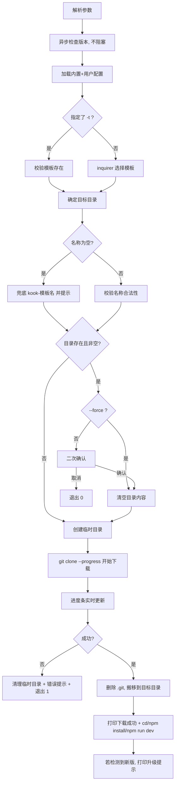

# kook-cli 脚手架 · 需求整理与实现方案 v0.1

> 状态：待确认，确认后进入实现
> 目标：做一个 Vue CLI 风格的模板脚手架，命令名 `kook-cli`（别名 `kook`）

---

## 一、已确认的技术选型

| 决策项 | 结论 |
| --- | --- |
| 语言 | JavaScript（CommonJS），零构建，`bin` 直接指向源码 |
| 下载方式 | `git clone --depth=1 --progress`，解析 stderr 拿真实百分比 |
| 配置来源 | 包内 `src/config.json` 作为默认值，`~/.kook-cli/config.json` 覆盖/追加 |
| 依赖安装 | 只打印 `cd / npm install / npm run dev` 三步提示，不代跑安装 |
| Node 版本 | `>= 16.14`（建议 18+），`package.json` 写 `engines` 并在启动时校验 |

> 注意：因为用 CommonJS，`chalk` 必须锁 **4.x**、`ora` 锁 **5.x**、`inquirer` 锁 **8.x**，5/6/9 及以上都是纯 ESM，`require` 会直接报错。这点容易踩坑，先写进方案。

---

## 二、功能点清单

### A. 你提出的 14 条 → 拆成可验收项

| # | 需求 | 实现要点 | 验收标准 |
| --- | --- | --- | --- |
| 1 | 查看版本 / `-h` 帮助 | commander 的 `-V, --version` 与 `-h`；`create`/`update`/`list` 各自有子命令帮助 | `kook-cli -V` 输出 `0.1.0`；`kook-cli -h` 输出命令表 |
| 2 | 可配置模板的 config.json | 包内默认配置 + 用户级 `~/.kook-cli/config.json` 深度合并 | 改了用户配置后 `kook-cli list` 立即生效，无需重装 |
| 3 | `kook-cli create 项目名` | 支持 `create <name>`、`create`（后续交互补问） | 两种写法都能进流程 |
| 4 | 交互式选择仓库 | inquirer `list`，展示模板 key + 中文描述 | 上下键选择 + 回车确认 |
| 5 | 进度条 + 百分比 + 阶段文案 | `cli-progress`；阶段：`开始下载` → `下载中 xx%` → `清理模板` → `下载成功` | 终端能看到平滑递增的进度条 |
| 6 | 下载成功提示 | 成功后再打印一次汇总（模板、路径、耗时） | 明确区分于进度条的「完成」 |
| 7 | 后续步骤提示 | 打印 `cd xxx` / `npm install` / `npm run dev` 三行，带颜色 | 命令可直接复制 |
| 8 | 项目名为空兜底 | 空串/纯空格 → `kook-${templateKey}`，并提示「已使用默认名称」 | `kook-cli create ""` 得到 `kook-vue3admin` |
| 9 | 覆盖目标文件夹 | 目录存在且非空 → 二次确认（默认 No）；`-f/--force` 跳过确认；只清空内容，保留目录本身 | 选 No 时干净退出、退出码 0 |
| 10 | 检测 npm 包版本 | 请求 registry 拿 `latest`，与本地 `version` 用 semver 比较 | 有新版时能打印最新版号 |
| 11 | `update` 方法 | 自动识别全局包管理器 → 执行 `<pm> install -g kook-cli@latest`，处理 EACCES | `kook-cli update` 一条命令升级完成 |
| 12 | create 时版本提醒 | 每次 `create` 启动时异步检查（不阻塞交互），有新版才提示 | 断网/超时不影响 create |
| 13 | 指定文案 | 按给定文案输出，统一加 `[kook-cli]` 前缀 | 文案与需求一致（见下方「待确认」） |
| 14 | 三个模板 | vue3admin / vue3H5 / uni-mini-program，URL 见 config 示例 | `list` 能看到三条 |

### B. 我补充的遗漏项（建议都做，按优先级）

| 优先级 | 补充功能 | 为什么需要 |
| --- | --- | --- |
| P0 | 下载到**临时目录**再搬移，失败/`Ctrl+C` 自动清理 | 否则中途失败会在目标目录留半成品，第二次 create 又触发「目录非空」 |
| P0 | 下载完删除 `.git` 目录 | 否则新项目带着模板仓库的提交历史和远端地址，一 `git push` 就出事 |
| P0 | 版本检查 **并行查询 + 3 秒超时 + 多源取最高版本**，永不抛出 | 国内直连 npmjs 慢，不能阻塞 `create`；镜像站有同步延迟，只取第一个结果会漏报 |
| P0 | registry 优先 `registry.npmmirror.com`，失败回退 `registry.npmjs.org` | 保证版本检测在国内可用 |
| P0 | 项目名校验：非法字符、`.`/`..`、绝对路径逃逸、Windows 保留名 | 防止 `create ../../etc` 这类污染 |
| P0 | 统一错误处理：网络失败 / git 未安装 / 权限不足，给可操作的中文提示 + 非 0 退出码 | 脚手架体验的分水岭 |
| P1 | `kook-cli list` 列出所有模板（含来源：内置/用户） | 不选模板也能先看看有什么 |
| P1 | `-t/--template`、`-f/--force`、`--no-check` 参数 | 支持脚本化和 CI，跳过一次版本检查 |
| P1 | 模板支持分支：config 里 `branch` 字段（默认 `master`） | Gitee 仓库有 master/main 两种，写死会 clone 失败 |
| P1 | 别名字段：`bin` 同时注册 `kook` 和 `kook-cli` | 少敲几个字符 |
| P1 | `git clone` 失败自动重试 1 次（浅克隆偶发超时） | 提升成功率 |
| P2 | 替换模板内 `package.json` 的 `name` 为新项目名 | 否则 `npm run dev` 时报的还是模板名，容易困惑 |
| P2 | 交互式流程支持「返回上一步」/`Ctrl+C` 优雅退出 | 选错模板不用重开 |
| P2 | 下载完成后可选「是否立刻打开编辑器」 | 锦上添花，默认关闭 |
| P2 | 纯函数单测（config 合并、进度解析、名称兜底）+ `npm pack` 冒烟 | 改配置逻辑时不怕回归 |

---

## 三、目录结构

```
kook-cli/
├── bin/
│   └── kook.js                 # #!/usr/bin/env node，require('../src/index')
├── src/
│   ├── index.js                # commander 装配、全局错误兜底、SIGINT 处理
│   ├── commands/
│   │   ├── create.js           # 主流程编排
│   │   ├── update.js           # 自升级
│   │   └── list.js             # 模板列表
│   ├── core/
│   │   ├── config.js           # 默认配置 + 用户配置深度合并、校验
│   │   ├── download.js         # git clone --progress + 进度解析
│   │   ├── target.js           # 名称兜底、路径校验、非空检测、清空
│   │   └── version.js          # 远程版本查询、多源取最高、semver 比较
│   ├── utils/
│   │   ├── log.js              # info/success/warn/error/tip，统一前缀与颜色
│   │   ├── pm.js               # 全局包管理器识别、执行命令
│   │   └── fs.js               # 临时目录、复制、删除封装
│   └── config.json             # 内置模板配置
├── test/                       # node:test 单测
├── package.json
├── README.md
└── PLAN.md
```

依赖：`commander` `inquirer@8` `chalk@4` `ora@5` `cli-progress` `fs-extra` `semver`
开发依赖：无（测试用 Node 自带 `node:test`）

---

## 四、config.json 设计

内置 `src/config.json`：

```json
{
  "registry": "https://registry.npmmirror.com",
  "checkUpdate": true,
  "templates": {
    "vue3admin": {
      "description": "Vue3 + Element Plus 后台管理模板",
      "url": "https://gitee.com/yinghuopocket/yyadmin.git",
      "branch": "master"
    },
    "vue3H5": {
      "description": "uni-app Vue3 H5 移动端模板",
      "url": "https://gitee.com/yinghuopocket/uni-vue3.git",
      "branch": "master"
    },
    "uni-mini-program": {
      "description": "uni-app 小程序模板",
      "url": "https://gitee.com/yinghuopocket/uni-app.git",
      "branch": "master"
    }
  }
}
```

用户级 `~/.kook-cli/config.json` 只需写要改的部分，合并规则：

- `templates` 按 key **覆盖**（同名替换，不同名追加）
- 顶层字段（`registry` / `checkUpdate`）**覆盖**
- 用户配置里的模板标记来源为「用户」，`list` 里会区分展示
- 配置文件 JSON 语法错误 → 明确报错行号，回退到内置配置而不是崩溃

> 分支名需要你确认一下三个仓库实际是 `master` 还是 `main`，我实现时会先 `git ls-remote` 探测，探测不到再用配置值。

---

## 五、命令设计

```
kook-cli -V | --version          查看版本
kook-cli -h | --help             查看命令
kook-cli create [name] [options] 创建项目
    -t, --template <key>         跳过交互直接指定模板
    -f, --force                  目标目录非空时直接覆盖，不二次确认
        --no-check               跳过版本更新检查
kook-cli list                    查看可用模板
kook-cli update                  升级脚手架自身
```

---

## 六、create 执行流程



---

## 七、关键实现细节

### 1. 进度条的百分比从哪来

`git clone --progress` 会把进度写到 **stderr**，形如：

```
Receiving objects:  47% (4210/8957), 12.30 MiB | 1.10 MiB/s
Resolving deltas:   83% (3001/3615)
```

解析 `/(\w[\w\s]+):\s+(\d+)%/`，取 `Receiving objects`（没有则取 `Resolving deltas`）的百分比驱动 `cli-progress`，同时把 `12.30 MiB | 1.10 MiB/s` 作为右侧附加信息展示。

阶段状态机：`开始下载` → `下载中 47%` → `清理模板 (.git)` → `下载成功`。若仓库太小进度瞬间到 100%，也要保证四段文案都出现（用 `ora` 短暂过渡）。

### 2. 覆盖目录的安全策略

```js
// 伪代码
if (exists(dir)) {
  if (isEmpty(dir)) { /* 直接用 */ }
  else if (force) { await emptyDir(dir) }
  else { const ok = await confirm(`目录 ${dir} 非空，确定覆盖？`); if (!ok) exit(0) }
}
```

只删**目录内的内容**，不删目录本身（避免用户当前 shell 所在目录被删）。删除前打印将删除的条目数。

### 3. 版本检查（不阻塞、不报错）

```
并行请求 npmmirror / npmjs 的 /kook-cli/latest
  → 各 3s 超时，失败静默跳过
  → 在成功的结果里取 semver 最高的版本（镜像站同步有延迟）
  → 与 create 流程并行，不阻塞下载
  → semver.gt(latest, current) 才提示
```

> 不落盘缓存：缓存会让「刚发布的新版本」在 TTL 内一直不提醒，这正是排查版本提醒不生效时踩到的坑。

提示文案（需求 13 原样，仅修正包名拼写）：

```
[kook-cli] 检测到 kook-cli 最新版: 0.2.0
[kook-cli] 当前版本: 0.1.0 ~
[kook-cli] 可使用 pnpm install -g kook-cli@latest 更新 ~
```

> 需求里写的是 `pnpm install kook-cli@latest`，全局安装缺 `-g`，按 `-g` 实现（否则只装到当前目录）。

### 4. 名称兜底与校验

| 输入 | 结果 |
| --- | --- |
| `create ""` / `create` 后直接回车 | `kook-vue3admin`，提示已兜底 |
| `create   `（纯空格） | 同上 |
| `create my-app` | `./my-app` |
| `create ../x` / `create /abs` | 拒绝：不支持相对/绝对路径 |
| `create a/b` | 拒绝：不支持多级目录 |
| 含 `<>:"|?*` 或 Windows 保留名（con、nul…） | 拒绝并提示原因 |

### 5. update 命令

1. 判断是否为全局安装（`npm root -g` 路径下是否存在 kook-cli），`npx` 临时运行则提示「当前不是全局安装，跳过」
2. 识别包管理器：`npm_config_user_agent` → 锁文件 → 兜底 npm
3. 先查最新版，已是最新则提示并结束
4. 执行 `<pm> install -g kook-cli@latest`，`stdio: 'inherit'` 让用户看到安装过程
5. EACCES → 提示「权限不足，可用 sudo 或修改 npm prefix」，不建议自动 sudo

### 6. 错误处理矩阵

| 场景 | 提示 | 退出码 |
| --- | --- | --- |
| 本机无 git | 未检测到 git，请先安装（附下载地址） | 1 |
| clone 鉴权失败 | 仓库无权限，请确认 Gitee 登录态或改为公开仓库 | 1 |
| 网络超时（重试后） | 网络异常，请检查代理后重试 | 1 |
| 目标目录不可写 | 无写入权限：<path> | 1 |
| 模板 key 不存在 | 未找到模板「x」，可用：a, b, c | 1 |
| 用户主动取消 | `已取消` | 0 |

`Ctrl+C` 时清理临时目录再退出，不留垃圾。

---

## 八、实施计划

| 阶段 | 内容 | 产出 |
| --- | --- | --- |
| 1 | 工程骨架：package.json / bin / log / commander 装配 | `kook-cli -V`、`-h` 可用 |
| 2 | config 加载合并、`list` 命令、模板选择交互 | `list` 正常，交互可选 |
| 3 | 下载核心：临时目录、git 进度解析、进度条、搬移、清 `.git` | 三个模板都能真实下载 |
| 4 | create 收尾：名称兜底、覆盖确认、后续提示 | 完整 create 流程跑通 |
| 5 | version/update：多源取最高、超时、`update` 命令 | 版本提醒与升级可用 |
| 6 | 单测 + `npm pack` 冒烟 + README | 可发布 |

验收方式：`npm link` 后真实跑 `kook-cli create demo -t vue3H5`、`kook-cli create ""`、`kook-cli create demo`（已存在目录）、断网跑一次，四个场景都要符合预期。

---

## 九、已确认细节

1. **文案拼写**：统一用 `kook-cli`，需求 13 里的 `koook-cli` 视为笔误。
2. **全局安装参数**：升级提示带 `-g`，即 `pnpm install -g kook-cli@latest`。
3. **模板改名**：下载后自动把 `package.json` 的 `name` 改为新项目名。
4. **模板分支**：实现时先 `git ls-remote` 探测 `master`/`main`，探测不到再用 config 里的 `branch`。
5. **依赖安装**：不代跑，只打印 `cd` / `npm install` / `npm run dev` 三步。

---

## 十、实现顺序（确认后执行）

阶段 1 → 2 → 3 → 4 → 5 → 6，每完成一个阶段我会停下来给你看一次可运行的效果，避免一次性铺完再返工。
